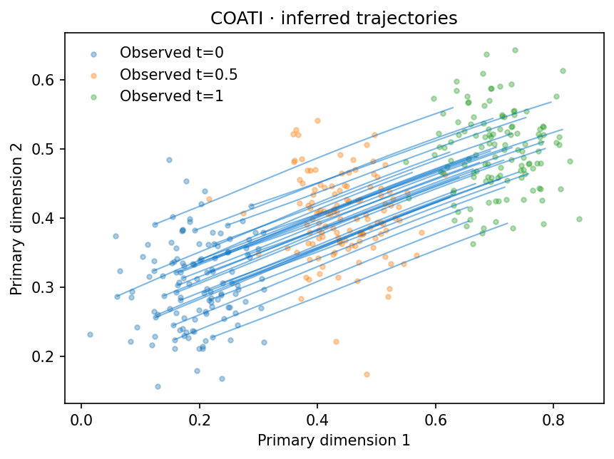

# Validation

Verified on 2026-09-10 using Python 3.10 on macOS ARM64, CPU, in a fresh isolated environment. No biological training was run.

The archived numerical results below used the earlier kernel-map default. They are not validation results for the new automatic FiLM default. Use `map_type="kernel"` when reproducing those runs. The automatic-map regression checks are in `tests/test_maps.py`, including stage exclusion, paired validation, quality warnings, frozen-map input gradients, normalization, user-provided maps and exact save/reload predictions.

On 2026-09-20, the default FiLM and time-independent MLP workflows were each run for 300 map epochs and 200 trajectory iterations on the paired toy with its middle stage omitted. Both completed without map-quality warnings and reproduced their primary and secondary predictions exactly after reload. The paired tutorial notebook was also executed with automatic FiLM fitting. These are CPU functional checks, not evidence of accuracy at held-out biological stages. The five original-engine equivalence checks were rerun with explicit kernel mapping and retained zero parameter differences.

The unbalanced synchronized secondary-energy correction dated 2026-10-31 is
validated separately below. Earlier unbalanced multimodal model outputs were not
retrained after that correction and remain historical workflow demonstrations.

## Biological temporal holdout

On 2026-10-12, a pancreas reconstruction run
was executed on paired RNA PCA50 / ATAC PoissonVI22 inputs. E15.5 (t = 1) was
excluded from both FiLM-map and vector-field fitting; E14.5 and E16.5 kept their
original times 0 and 2. The vector-field checkpoint records exactly 1,000
iterations, and RNA/ATAC predictions agreed after save/reload. The map passed its
within-retained-stage validation checks; this does not establish unseen-stage map accuracy.

The notebook includes shared UMAPs fitted only on retained observations and
representation-space distribution scores. Mean Sinkhorn reconstruction scores
were 0.3796 for RNA and 0.4914 for ATAC, versus 0.6399 and 0.7794 for the initial
distributions. The equal endpoint-mixture baseline scored 0.3904 and 0.4573,
so the short run did not beat that baseline in both modalities. These are one-seed
results with five subsampling repeats, not convergence or biological-superiority claims.
The existing all-data reduced representations and scalar normalization were fixed;
this is not an end-to-end raw-data holdout. The resolved settings and input hashes
are recorded in `provenance/heldout_pancreas_1000.json`.

The optional W2 scalar-normalization branch was also executed for 1,000
vector-field iterations, including checkpoint reload and shared UMAP projection.
Its RNA and ATAC scales were fitted only at times 0 and 2. Changing all held-out
values by a factor of 100 left both fitted scales unchanged, and converting the
working inputs back to their selected input units reproduced the source features.
The default branch retained identical reconstruction scores. Details are recorded
in `provenance/heldout_normalization_validation.json`.

## Original-engine equivalence

Same data, float32 precision, settings and seed in the original and packaged engines. The original device selector is overridden to CPU **only in the comparison harness**; its source files remain untouched.

| Mode | Iterations | Maximum parameter difference |
| --- | ---: | ---: |
| Balanced | 4 | 0 |
| Kernel synchronization | 4 | 0 |
| Unbalanced | 4 | 0 |
| Adaptive lambda | 4 | 0 |
| Synchronized, including gradient diagnostic | 100 | 0 |

The 100-step reference uses an enabled secondary density term, where the original diagnostic is defined. A separate regression check covers a disabled density term, which crashes the original diagnostic and is handled in the COATI copy. These checks establish equality for the tested cases, not every possible backend or experimental option.

## 200-step CPU toy runs

All use seed 0 and 128 initial cells. Endpoint Sinkhorn uses the original per-time median blur, evaluated on all endpoint samples. The floor was estimated with smaller training batches; it is context rather than an exact full-sample threshold.

| Example | Before transport | After transport | Kinetic energy |
| --- | ---: | ---: | ---: |
| gaussian | 0.147707 | 0.000455 | 0.139834 |
| split | 0.146521 | 0.003423 | 0.153955 |
| paired | 0.147707 | 0.000166 | 0.148672 |
| unbalanced | 0.146521 | 0.003776 | 0.001169 |

These arrays were not W2-normalized: kinetic energy need not be near one. Unbalanced energy is stored per particle with mass weights; the reported mean is not the total action. Its predicted total mass ratio is **0.9676**, versus an observed ratio of **2.0**. The short run verifies execution and geometric transport but has **not converged in mass**. Endpoint Sinkhorn is unweighted and should not be interpreted as a mass-aware unbalanced score.

## Interfaces and tutorials

- 12 regression checks passed: adapters, invalid input rejection, save/reload, normalization, secondary projection, accurate kernel and the 100-step disabled-loss diagnostic.
- All four notebooks executed cell by cell, including 200-step training and exact prediction reload checks.
- The Sphinx site builds with warnings treated as errors.
- Core source hashes and both original repositories' starting status are rechecked for preservation.

Machine-readable records are in `provenance/`: `equivalence.json`, `toy_metrics.json`, `notebook_execution.json`, and the tested package list. `scripts/verify_equivalence.py` reruns the read-only original comparison when a TraInf checkout is available.

## Scope

CPU results only. GPU/MPS, long biological training runs, full flow-matching pipelines and downstream molecular analyses have not been validated here. The toy checks and short biological holdout establish execution for these examples, not biological superiority.

## AnnData conventions and UMAP growth

On 2026-10-12, all 47 package checks passed after adding input preparation and
UMAP dynamics functions. Direct AnnData and TemporalData training produced
identical model parameters for the tested single- and multimodal unbalanced
examples. Analytic growth checks matched the saved ODE derivative, including its
`alpha_growth` multiplier. Tests covered metadata ambiguities, array conversion,
categorical time mappings, paired features, reordered cells, colors and labels,
copy-based storage and h5ad reload.

The unbalanced script ran for 300 iterations; the balanced script ran for 200.
Both produced a fitted UMAP, figure and stored vectors, with exact numerical
save/reload checks. The new dynamics notebook executed all six code cells.
Balanced results did not fabricate growth values. This validates the interfaces
and plotting behavior, not converged population mass or biological accuracy.
Records are in `provenance/anndata_dynamics_validation.json`. The training
algorithm under `src/coati/_core/` was not changed.

## Gastrulation UMAP dynamics

The [biological dynamics tutorial](tutorials/gastrulation/gastrulationDynamics.ipynb)
loads the current full-data unbalanced COATI checkpoint trained for 20,000 iterations
with seed 0 and Cy=0.5. It reuses the supplied RNA UMAP and displays all 11,470 E8.5
cells with the fitted velocity field and instantaneous growth. No UMAP is refitted,
and no new cell-type inference is performed.

The same checkpoint is used for the NMP mass decomposition below. This is a fitted-model
analysis, not a proliferation measurement or an independent biological validation.

## Lineage molecular readouts

On 2026-10-12, all 56 package checks passed after adding downstream feature
readouts and explicit later-start inference. Tests cover dense/CSR/CSC feature
extraction, cell/variable reordering, exact and duplicate neighbor matches,
binary probabilities, support masking, stable growth weighting, missing-lineage
rejection, fixed-baseline validation and unchanged default integration results.
The original training engine was not modified.

The [lineage tutorial](tutorials/09_lineage_features.ipynb) executed on 237 E8.0
NMP starting cells, integrating to E8.75 with the existing 1,000-step gastrulation
checkpoint. No path passed the Somitic endpoint threshold and support screen.
The tutorial reports no NMP-to-Somitic molecular curves for that checkpoint;
additional plots are explicitly NMP-origin diagnostics. Their observed markers
represent different annotation cohorts, not longitudinal measurements.

Three genes and three promoter-candidate peaks were extracted from source H5AD
files in bounded blocks with verified barcode order. Local decoders withheld
7,101 cells from fitting. Gene skill versus a fixed training-mean baseline was
0.660 (T), 0.320 (Sox2) and 0.337 (Tbx6). Peak Brier skill was -0.020, 0.227 and
-0.005 for the displayed features: two peaks did not improve the constant open
fraction baseline. Source PCA/LSI and scales remained fixed, so this is a decoder
holdout, not an end-to-end preprocessing or vector-field holdout.

The notebook also ran from its own directory; the standalone script reproduced
its endpoint screening and feature readout results. Machine-readable settings,
scope and readout values are in `provenance/lineage_feature_validation.json`.
These checks validate software behavior, not a recovered Somitic lineage,
regulation or chromatin priming.

## Cell-type mass accounting

The updated [gastrulation dynamics tutorial](tutorials/gastrulation/gastrulationDynamics.ipynb)
tracks all 9,018 E7.5 particles through E8.0 to E8.5 with the current 20,000-step
unbalanced checkpoint. With stage-matched one-neighbor RNA50 labels and globally
normalized endpoint mass, NMP contributions are +4.731281 incoming, -1.012193
outgoing and +0.447255 retained reweighting percentage points. Their sum,
+4.166343, equals the predicted proportion difference from 3.57% to 7.74%.
The cross-sectional observed difference is displayed separately. These values
illustrate the fitted model's relative-mass accounting, not independent biological
transition estimates.

Tests check the exact identity on retained, entering, leaving and unrelated
particles, normalization over the full population, stability under large log
mass offsets, balanced weights, explicit stage/time mapping, missing predicted
types, reference row order, invalid intervals/weight axes and plot signs.

## Mass-weighted secondary kinetic energy

On 2026-10-31, eight targeted regression cases checked the real ODE/loss pipeline
against known particle actions: increasing, decreasing and constant mass; initial
total mass different from one; agreement with balanced energy at uniform constant
mass; gradients through growth and initial log mass; particle-specific motion and
actual solver step lengths; time-dependent mapping; and mass carried between
successive observed intervals. Balanced energy keeps the original code path.
See {ref}`the migration note <secondary-energy-mass-weighting>` for the
formula and the distinction from earlier unbalanced synchronized training.

The complete suite passed 74 tests. A separate 100-iteration multimodal,
unbalanced Gaussian-bump run completed with finite model parameters,
trajectories and log masses, and predictions agreed exactly after reload.
This is a functional training check, not a convergence or accuracy claim.

## Fresh Gaussian map and synchronized transport

The Gaussian-bump examples under [Synthetic data](tutorials/syntheticdata/index.md) reuse committed,
reproducible AnnData and a frozen map generated by the repository build script.
The initial covariance is
0.004 I2 and both terminal covariances are 0.003 I2. AnnData stores the 3000
observed cells and a separate 10000-pair map-fitting pool. Both balanced and
unbalanced experiments therefore use identical observations and T.

T uses the original FourierBumpMLP architecture and weighted supervised objective:
6000 AdamW steps, batch 768, learning rate 1e-3, z weight 12, and an 85/15 seeded
split. State selection uses validation loss; the selected step is 1500.

| Evaluation | Pairs | XY RMSE | z RMSE | z MAE |
| --- | ---: | ---: | ---: | ---: |
| Held-out observed | 434 | 0.000047 | 0.021079 | 0.004067 |
| Held-out support | 1066 | 0.000065 | 0.005544 | 0.003500 |
| Independent grid | 9216 | 0.000067 | 0.005036 | 0.002998 |

The independent-grid height correlation is 0.999378. The predicted height at
(0.5, 0.5) is 0.999919, with target 1. Observed pairs have zero target height;
support and grid targets follow the bump surface, so their errors are reported
separately. The grid does not enter fitting or state selection.

The two balanced fields use the concise public Config interface. The tutorial
overrides only 3000 steps per model, batch 256, hidden width 256, adaptive Sinkhorn
penalties and Cy=0.5; two hidden layers, LeakyReLU, learning rate 1e-3, dt 0.1 and
the remaining loss settings use COATI defaults. Both start from the same fresh
random initialization. There is no warm-up. The synchronized field uses the
frozen T; support points are not trajectory snapshots.

| Model | Endpoint Sinkhorn | Primary kinetic energy | Secondary kinetic energy | Median maximum mapped height |
| --- | ---: | ---: | ---: | ---: |
| Without sync | 0.000206 | 0.161313 | 0.999115 | 0.380628 |
| With sync | 0.001425 | 0.213448 | 0.266299 | 0.038393 |

The balanced Cy sweep uses that same no-sync baseline and the same 3000-step
budget and initialization for every synchronized run. It reports the fitted
models directly under the fixed optimization budget.

| Cy | Endpoint Sinkhorn | Secondary kinetic energy | Median maximum mapped height |
| ---: | ---: | ---: | ---: |
| 0.1 | 0.000120 | 0.374621 | 0.093191 |
| 0.5 | 0.001425 | 0.266299 | 0.038393 |
| 0.7 | 0.000807 | 0.232102 | 0.029090 |

All 1000 initial particles are plotted without path selection or smoothing.
Balanced target and predicted mass are one, despite the larger sampled terminal
snapshot. The unbalanced tutorial sets `biological_num=[1, 2]`, mass coefficient
100 and global mass matching. At beta=1, its predicted terminal masses are 1.980399
without sync and 1.981807 with sync. At beta=0.1, they are 1.940608 and 1.962171,
respectively, against target 2. Analytic Gaussian-bump contours are
exact concentric circles. All 21 notebook code cells completed, and 85 package/example
checks passed locally. The training core is unchanged. Numeric results and data hashes
are recorded in `provenance/syntheticdata_gaussian_validation.json` in the COATI repository.
Earlier analytic-map results remain in `provenance/gaussian_sync_validation.json`.

## BranchSync

The [BranchSync tutorial](tutorials/syntheticdata/BranchSync.ipynb) regenerates the
five paired ToySplit snapshots from the original seed-42 recipe. Each stage contains
400 paired two-dimensional cells. The generated primary and secondary arrays match
the Figure 2b source NPZ arrays exactly. Spatial x-coordinate bins cover [0, 1], while
the balanced model retains the separate historical training-time grid 0, 1, 2, 3, 4.

The notebook refits the original raw-coordinate FiLM map rather than loading the legacy
checkpoint. It preserves width 64, three layers, time width 32, the 300-epoch budget,
batch size 256, paired 80/20 per-stage split, AdamW settings and time-balanced raw MSE.
No feature or time standardization is applied. Every fifth epoch is evaluated by the sum
of the five validation Sinkhorn divergences, matching the historical checkpoint rule.
The selected epoch is 295. Held-out paired RMSE across the five stages is 0.002397,
0.016145, 0.017249, 0.023427 and 0.027798.

Both balanced vector fields use 10,000 iterations, width 256, two LeakyReLU layers,
batch size 128, learning rate 1e-3, kinetic-energy coefficient 0.1 and primary matching
coefficient 10. BranchSync uses Cy=0.9 and secondary manifold coefficient 100; the
primary-only control uses manifold coefficient 1. Both start from identical weights.
The primary adaptive matching coefficient starts and is capped at 10, while the
BranchSync secondary coefficient starts and is capped at 100. At iteration 10,000,
BranchSync's weighted primary and secondary PDF-to-primary-energy gradient ratios are
4.70 and 130.83, respectively; its density-to-primary-energy gradient ratio is 378.22.
The requested secondary constraints therefore dominate the final gradient diagnostic.

| Model | Primary terminal separation | Mapped terminal separation | Secondary endpoint Sinkhorn | Primary endpoint Sinkhorn |
| --- | ---: | ---: | ---: | ---: |
| Primary only | 0.093899 | 0.267969 | 0.000615 | 0.000419 |
| BranchSync | 0.094217 | 0.269675 | 0.000302 | 0.000251 |

Separation is distributional: at the terminal time, the upper and lower halves are
defined by the current y-coordinate median. No per-cell lineage identity is assumed.
The comparison plot shows individual trajectories in one color without an average path.
Full settings and source hashes are recorded in
`provenance/branch_sync_validation.json`.

## Mouse gastrulation quickstart

The [Mouse gastrulation tutorial](tutorials/gastrulation/mouseGastrulation.ipynb) contains the
minimal data preparation, training and UMAP workflow. All nine cells were executed
on 35,503 paired cells at four observed times, using RNA50 and ATAC14 in their
supplied normalized representation. The cross-modal map passed its internal
validation, followed by 1,000 vector-field training iterations.

One UMAP shows observed E8.5 cell types and the projected COATI flow. The Python
script was checked by reloading the saved result and reproducing the view.
Pairing, model inputs, source-file hashes and finite nonzero velocities were
verified. The training core and original project are unchanged. This short run
is a workflow demonstration; it does not establish biological accuracy.
Settings and validation details are in `provenance/gastrulation_quickstart.json`.
